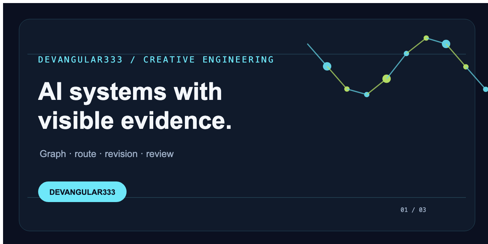
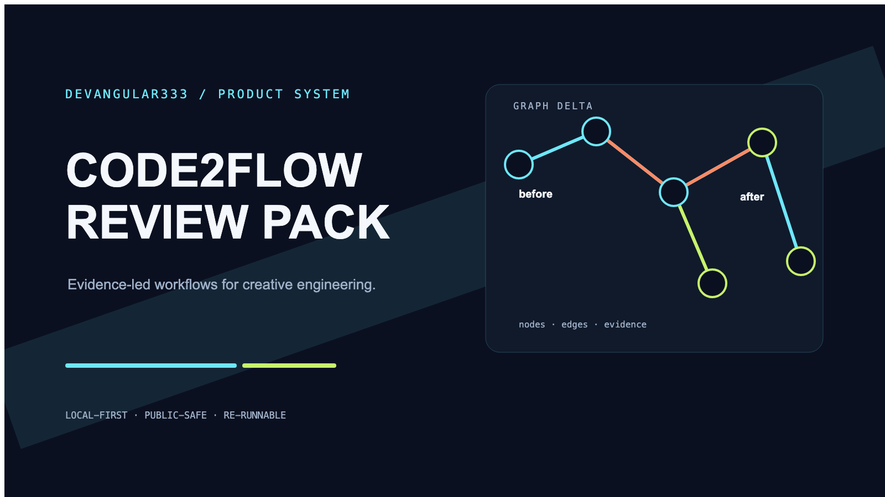
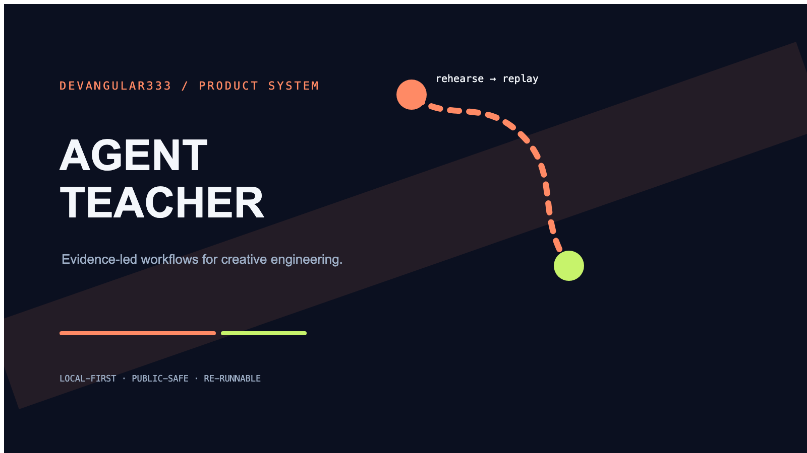
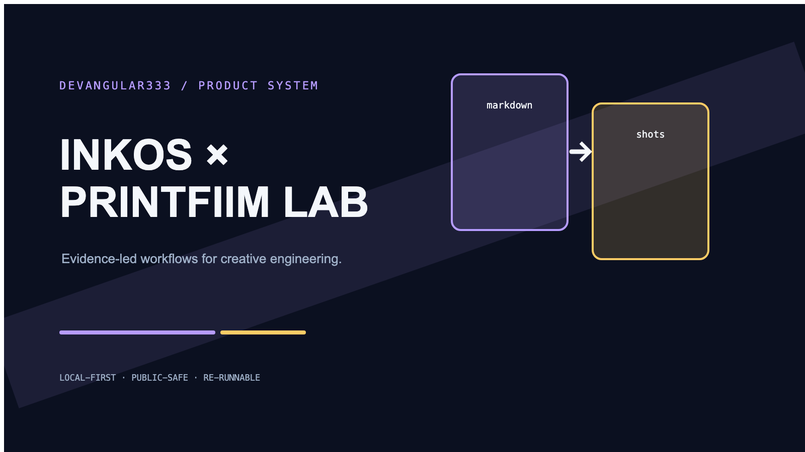

# DevAngular333

<picture>
  <source media="(prefers-color-scheme: dark)" srcset="./assets/profile-hero-dark.svg">
  <source media="(prefers-color-scheme: light)" srcset="./assets/profile-hero-light.svg">
  
</picture>

## Tôi xây AI systems và developer tools thành sản phẩm thực dụng, có demo và quy trình kiểm chứng.

Tôi tập trung vào ba trụ cột:

- **Local-first AI workflows** — dữ liệu, trạng thái và giới hạn được nói rõ.
- **Developer tools có bằng chứng** — đầu ra có thể chạy lại, xem diff và kiểm tra.
- **Learning và creative systems** — biến ý tưởng thành luồng sử dụng cụ thể.

## Dự án nổi bật

**Xem sản phẩm hoạt động:** [video chính và demo trong portfolio](https://devangular333.github.io/devangular333-portfolio/#review-pack-video) · [GIF preview](https://devangular333.github.io/devangular333-portfolio/assets/code2flow-review-pack-preview.gif) · [release media](https://github.com/DevAngular333/design-os-code/releases/tag/v0.5.1-devangular333)

### [Code2Flow Review Pack](https://github.com/DevAngular333/design-os-code)

**Đã phát hành · v0.5.1-devangular333**

Code2Flow chuyển codebase web thành flow canvas có screenshot và evidence `file:line`. Đóng góp riêng của tôi là Review Pack: so sánh hai graph revision, đưa thay đổi vào danh sách reviewer có thể mở source evidence, ghi chú/trạng thái và export JSON. Demo dùng fixture CRM synthetic có nhãn; smoke offline chỉ kiểm tra đường chạy của công cụ.

- [Release đã xác minh](https://github.com/DevAngular333/design-os-code/releases/tag/v0.5.1-devangular333)
- [Case study](https://github.com/DevAngular333/design-os-code/blob/master/docs/case-study.md)
- [Try demo](https://devangular333.github.io/devangular333-portfolio/review-pack-demo.html)
- [Video 58 giây và poster](https://devangular333.github.io/devangular333-portfolio/#review-pack-video)
- Thử nhanh: `npm ci && npm run review:demo`
- Giới hạn: `related/unrelated` là focus-term matching xác định trên graph label/path; nó không suy luận semantic impact và không thay thế kiểm tra runtime.

### [Agent Teacher · Vietnamese fraction rehearsal](https://github.com/DevAngular333/design-os-pedagogy)

**Đã phát hành · v0.1.1-devangular333**

Fork PolyForm Shield của [`jangtrinh/design-os-pedagogy`](https://github.com/jangtrinh/design-os-pedagogy). Tôi phát triển luồng rehearsal local cho bài phân số tiếng Việt: coaching authored, transfer, replay và Markdown export để người dạy đọc lại một phiên cụ thể. Smoke runner bằng Python standard library chỉ là kiểm tra kỹ thuật cho HTTP, replay và export.

- [Release đã xác minh](https://github.com/DevAngular333/design-os-pedagogy/releases/tag/v0.1.1-devangular333)
- [Case study](https://github.com/DevAngular333/design-os-pedagogy/blob/main/docs/case-study.md)
- Thử nhanh: `python3 scripts/smoke_flow.py`
- Giới hạn: dữ liệu là authored simulation; chưa semantic grading, expert review, pilot hay certification.

### [InkOS × PrintFilm Lab](https://github.com/DevAngular333/inkos-printfilm-lab)

**Đã phát hành · v0.2.0-devangular333**

Bridge file-based từ Markdown/JSON export sang project fields, có smoke CLI và case study. InkOS được ghi nhận AGPL-3.0; license PrintFilm chưa xác minh.

- [Release đã xác minh](https://github.com/DevAngular333/inkos-printfilm-lab/releases/tag/v0.2.0-devangular333)
- [Case study](https://github.com/DevAngular333/inkos-printfilm-lab/blob/main/docs/case-study.md)
- Thử nhanh: `npm test && npm run smoke`

## Cách tôi kiểm chứng

1. Chốt input, thao tác, output và lỗi quan trọng trước khi sửa.
2. Chạy luồng chính bằng dữ liệu mẫu có nhãn hoặc dữ liệu local.
3. Đọc lại commit, release, tree và URL công khai sau khi phát hành.
4. Ghi rõ phần đã đọc code, đã chạy, đã phát hành và chưa kiểm chứng.

## Portfolio và bằng chứng trực quan

Xem [portfolio đã triển khai](https://devangular333.github.io/devangular333-portfolio/) để đi từ vấn đề → luồng dùng thử → repo, release, case study và ảnh chụp từ phiên bản đã chạy.

## Selected work

- [design-os-knowledge-builder](https://github.com/DevAngular333/design-os-knowledge-builder) — compiler tạo knowledge packs local-first; backlog ưu tiên tiếp theo.
- [marketing-seeding](https://github.com/DevAngular333/marketing-seeding) — dashboard local cho campaign brief, draft, review, approval và evidence; public-safe audit tiếp tục.
- [DevAngular333 repositories](https://github.com/DevAngular333?tab=repositories)

## Liên hệ

GitHub là kênh công khai hiện đã xác minh: [@DevAngular333](https://github.com/DevAngular333).

Profile này ưu tiên bằng chứng có thể chạy lại. Dữ liệu tài khoản, runtime local và thông tin riêng không được đưa vào repo công khai.
